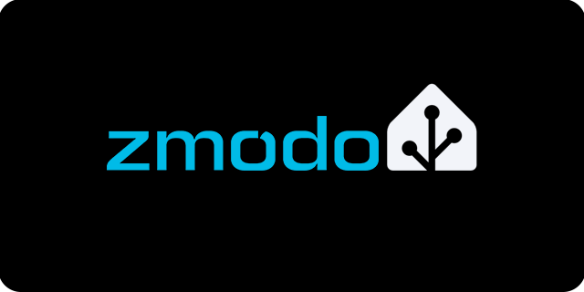

  

# Zmodo Home Assistant Integration

[![HACS Custom][hacs-shield]][hacs-url]
[![GitHub Release][release-shield]][release-url]

[![License][license-shield]](LICENSE)

A Home Assistant custom integration for **Zmodo / MeShare** cloud cameras.

> **Note:** This integration uses Zmodo's cloud. Since October 2026 the camera list, motion alerts and live video come from the new **user.zmodo.com** platform; camera settings (microphone, volume, frame rate, night vision, notifications) and the device picture still use the older MeShare app API and become unavailable whenever that API is down. Alert image/clip URLs are Home Assistant paths (e.g. `/api/zmodo/alert/<entry>/<alert>/clip`) that require HA authentication, so they work directly in companion-app notifications. Account login, device discovery, settings and alerts all require the Zmodo/MeShare cloud — local-only setups are not supported. **Live video**, however, can optionally be pulled **directly from a camera on your LAN** (~1 s latency instead of ~30 s, and HD-capable) — see [Local (LAN) streaming](#-local-lan-streaming-).

---

## ⚡ Features ⚡

- 📷 **Camera entities** — live SD stream for each device (decrypted and relayed locally by Home Assistant)
- 🏠 **Direct LAN streaming (optional)** — stream straight from a camera on your network (~1 s latency vs ~30 s cloud), with a concurrent **HD (1080p)** entity; automatic cloud fallback when off-LAN. See [Local (LAN) streaming](#-local-lan-streaming-)
- 🎦 **Camera frame rate** — choose from low to high frame rate to control video quality
- 🔔 **Motion alert sensors** — last alert timestamp and 24-hour alert count per camera
- 🔊 **Volume slider** — increase and decrease device volume levels
- 🎙️ **Microphone switch** — turn your device's microphone on or off
- 🌙👁️ **Nightvision** — configure on/off/auto with sensitivity settings low/normal/high
- 🔃 **Automatic re-authentication** — renews the platform token before it expires and recovers the legacy session on its own (no captcha, no re-entering credentials)
- 🔌 **Config flow** — set up from the HA UI with just your email and password

---

## 📖 Installation 🗺️

### 🔄 Via HACS (recommended) 🔄

1. In Home Assistant, go to **HACS → Integrations**.
2. Click the three-dot menu (⋮) and choose **Custom repositories**.
3. Add `https://github.com/iamdoubz/ha-zmodo` as an **Integration**.
4. Find **Zmodo** in the HACS store and click **Download**.
5. Restart Home Assistant.

### ⬇️ Manual ⬇️

1. Download the [latest release](https://github.com/iamdoubz/ha-zmodo/releases/latest).
2. Copy the `custom_components/zmodo` folder into your HA `config/custom_components/` directory.
3. Restart Home Assistant.

---

## ⚙️ Setup ⚙️

1. Go to **Settings → Devices & Services → Add Integration**.
2. Search for **Zmodo**.
3. Enter your **Zmodo / MeShare email** and **password**.
4. Devices are discovered automatically.

---

## 💡 Entities 💡

For each camera discovered on your account, the following entities are created:

| Entity | Type | Description |
|---|---|---|
| `camera.<name>_sd` | Camera | Live stream (640×480) — local substream or cloud |
| `camera.<name>_hd` | Camera | Live stream (1920×1080), **LAN only** — appears when a local host is configured |
| `sensor.<name>_last_alert` | Timestamp | Time of the most recent motion event |
| `sensor.<name>_alert_count_24h` | Number | Motion alert count in the last 24 hours |
| `image.<name>_last_alert_image` | Image | Last motion clip image thumbnail |
| `image.<name>_device_image` | Image | Physical device image |
| `camera.<name>_last_alert_clip` | Camera | Last motion clip video (480p) |
| `sensor.<name>_last_alert_image_url` | String | Last motion clip image URL |
| `sensor.<name>_last_alert_video_url` | String | Last motion clip video URL |
| `switch.<name>_notifications` | Switch | Toggle notifications |
| `switch.<name>_microphone` | Switch | Toggle device microphone |
| `number.<name>_volume` | Number | Device volume slider |
| `select.<name>_frame_rate` | Select | Select device video frame rate |
| `select.<name>_night_vision_mode` | Select | Select device nightvision mode |
| `select.<name>_night_vision_sensitivity` | Select | Select device nightvision sensitivity |
| `button.<name>_pan_up` / `_down` / `_left` / `_right` | Button | PTZ pan/tilt — each press nudges the camera (PTZ cameras only) |

---

## 🏠 Local (LAN) streaming 🏠

By default live video is relayed from the Zmodo cloud, which adds ~30 s of
latency. If your camera and Home Assistant are on the same network, you can pull
the stream **directly from the camera** over the LAN instead (~1 s latency), and
unlock a concurrent **HD (1080p)** stream.

**Enable it:** go to the Zmodo integration → **Configure**, and enter each
camera's **LAN IP address**. Leave an IP blank to keep that camera on the cloud.

When a camera has a LAN IP set:

- its `camera.<name>_sd` entity streams the 480p substream directly (falling back
  to the cloud automatically when the camera is off-LAN), and
- a new `camera.<name>_hd` entity appears for the 1080p mainstream. HD exists only
  over the LAN — the cloud has no HD stream — so it's unavailable when off-LAN.

Both qualities run at once over two direct connections. The `quality` and
`stream_source` (`local`/`cloud`) attributes on each camera show what's active.

This was reverse engineered on the Ambarella S2L camera generation (model
`SD-H2001`, `product_id` 142). Other models of the same generation often work
with no changes — if yours doesn't stream locally, see
[docs/PORTING_LOCAL_STREAM.md](docs/PORTING_LOCAL_STREAM.md) for how to check and
contribute support.

> ⚠️ These cameras ship with anonymous FTP and an empty-password root account.
> Keep them on an isolated IoT VLAN with no inbound internet regardless of
> whether you use local streaming.

---

## 🗑️ Known limitations 🤦

- **Cloud for everything but local video**: Account login, device discovery,
  settings and alerts all pass through Zmodo/MeShare servers. Live video can run
  locally (see above); nothing else does.
- **PTZ is cloud-only**: Pan/tilt runs over Zmodo's cloud command channel (there
  is no LAN path for it), so the `button.<name>_pan_*` controls need the camera
  and your account online. Each press nudges the camera briefly then stops;
  there is no continuous hold or absolute positioning.
- **Token refresh**: The session token expires every ~24 minutes. The integration refreshes it proactively every 20 minutes using the `login_cert` obtained at login — identical to the mobile app behaviour.

---

## ⁉️ Troubleshooting 💥

| Symptom | Likely cause | Fix |
|---|---|---|
| `invalid_auth` at setup | Wrong email/password | Re-enter credentials |
| Camera shows unavailable | `device_online = 0` in the Zmodo cloud | Camera is offline |
| Stream won't load | Token expired mid-stream | Wait for the 20-min refresh cycle, or reload HA |

---

## 🧠 Contributing 🥼

Pull requests welcome! Please open an issue first to discuss major changes.

Adding local-stream support for another Zmodo camera model? See
[docs/PORTING_LOCAL_STREAM.md](docs/PORTING_LOCAL_STREAM.md) and the
`tools/probe_local_stream.py` helper.

---

[hacs-shield]: https://img.shields.io/badge/HACS-Custom-orange.svg?style=for-the-badge
[hacs-url]: https://github.com/hacs/integration
[release-shield]: https://img.shields.io/github/release/iamdoubz/ha-zmodo.svg?style=for-the-badge
[release-url]: https://github.com/iamdoubz/ha-zmodo/releases
[license-shield]: https://img.shields.io/github/license/iamdoubz/ha-zmodo.svg?style=for-the-badge
